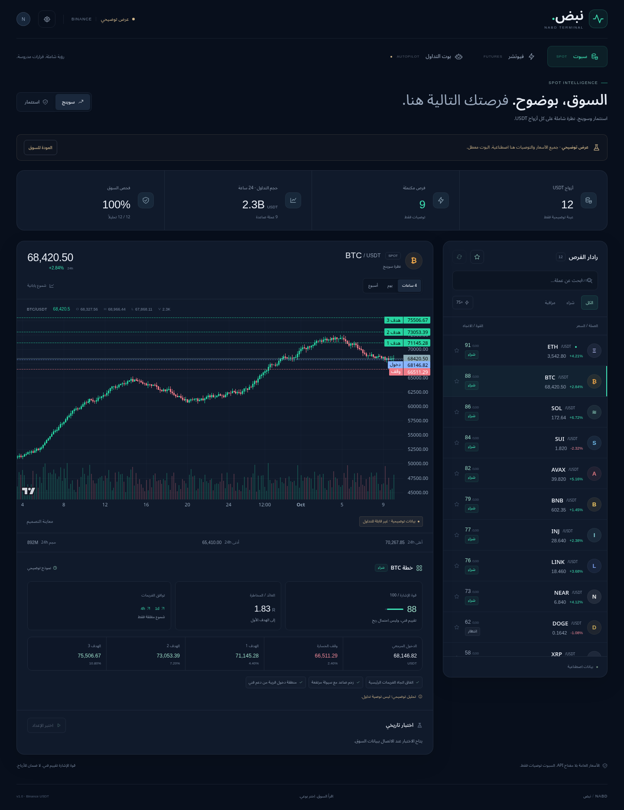

# نبض · NABD

تطبيق عربي لـ iPhone لتحليل أسواق Binance مباشرة دون خادم أو مفتاح API، مع بوت فيوتشر اختياري على جهازك وإشعارات تليجرام. يمكن نشر الواجهة مجانًا على GitHub Pages. مشروع iOS ومسار استخراج IPA عبر GitHub مرفقان. **هذه حزمة المصدر؛ لا تحتوي IPA مبنياً أو موقعاً منشوراً.**



## الوظائف

- كل أزواج USDT النشطة: مزامنة `exchangeInfo` وإزالة المحذوفة، مع فحص تدريجي عادل دون حد لعدد العملات. الفيوتشر يشمل عقود USDT الدائمة.
- سبوت للتوصيات فقط: سوينج `1d/4h`، واستثمار `1w/1d/4h`. بيانات السوق لا تحتاج مفتاح API.
- فيوتشر: تحليل `1h/15m/3m`؛ شارت يمكن تغييره إلى `3m/5m/15m/30m/1h`.
- شارت شموع تفاعلي مبني بمكتبة Lightweight Charts من TradingView، مع تحديث WebSocket وREST، حجم التداول وخطوط الدخول والوقف والأهداف. شارت السبوت `4h/1d/1w`.
- خطة مختصرة لكل عملة: الدخول، الوقف، ثلاثة أهداف، العائد إلى المخاطرة، أسباب الترشيح والتحذيرات. البحث والمفضلة وفلاتر قوة الإعداد والاتجاه تعمل على جميع الأزواج.
- بوت فيوتشر: محاكاة ورقية، Binance Testnet، أو تداول حقيقي على جهاز يعمل باستمرار، مع إشعارات تليجرام. مفاتيح HMAC على جهاز البوت فقط؛ هامش معزول واتجاه واحد؛ أوامر حماية على المنصة وسجل SQLite دائم.
- اختبار تاريخي يستخدم المعلومات المتاحة وقت القرار، الدخول في افتتاح الشمعة التالية، العمولات والانزلاق، وأولوية الوقف إذا لمس الشمعة الوقف والهدف معاً.

## ابدأ

**إصدار iPhone:** [خطوات GitHub وإخراج IPA](docs/IOS_AR.md).

**للرفع من iPhone دون فك ZIP:** [ملف مضغوط وworkflow منفصل](docs/PHONE_UPLOAD_AR.md). ارفع الأرشيف كما هو، وضع ملف التشغيل في `.github/workflows/`؛ يتولى GitHub استيراد المصادر والبناء.

**البيانات مجانًا دون خادم:** [الاتصال المباشر ونشر GitHub Pages](docs/FREE_AR.md). يبني GitHub Actions التطبيق وينشر الواجهة؛ التحليل الفني يجري داخل الواجهة. يبدأ التطبيق بوضع «مباشر من Binance» دون رابط أو `APP_TOKEN`.

**البوت الحقيقي دون اشتراك استضافة:** [تشغيل البوت على جهازك وتليجرام](docs/TELEGRAM_AR.md). تحتاج جهازًا يعمل باستمرار ومفاتيح Binance؛ توكن تليجرام وChat ID للإشعارات. [الربط عبر HTTPS](docs/DEPLOY_AR.md) مطلوب للتحكم من iPhone أو Pages.

**النسخة القديمة المثبتة تطلب رابط خادم؟** أعد بناء هذه النسخة ووقّع IPA عبر ESign. وضع رابط Pages في خانة الخادم بالنسخة القديمة لن يجعلها تعمل؛ Pages لا يشغّل Python.

للتشغيل المحلي، Python 3.12 وNode 22 أو أحدث:

```bash
python3 -m venv .venv
.venv/bin/pip install -r backend/requirements.txt
cd frontend
npm ci
npm run build
cd ..
bash scripts/run-backend.sh
```

افتح `http://127.0.0.1:8000`. بيانات السوق عامة وتعمل مباشرة في الواجهة. لإدارة البوت، اختر «خادم البوت» في إعدادات التطبيق وأدخل عنوان الجهاز والرمز الموجود محلياً في `backend/data/.app-token` أو `APP_TOKEN` الذي حددته عليه. لا تنشر الرمز. للواجهة فقط أثناء التطوير: `cd frontend && npm ci && npm run dev`؛ لا تحتاج Python أو تشغيل backend.

## التحليل وحدوده

طريقة التحليل الأصلية محفوظة كاملة في وضع الاتصال المباشر؛ نُقلت الحسابات إلى TypeScript مع اختبار تطابقها مع Python. لا تُضاف فلاتر للتوصيات أو مدة صلاحية مختصرة عند تغيير الاستضافة أو طريقة الاتصال.

يتوافق الاتجاه عبر الأطر، ويجمع RSI وMACD وADX وATR والحجم وبنية الدعم والمقاومة وسياق بيتكوين وتمويل الفيوتشر. يتحقق البوت من السبريد وعمق السوق قبل الأوامر. درجة 0–100 **قوة إعداد فني وليست احتمال نجاح**. لا توجد نسبة فوز حي مثبتة أو ادعاء باستبدال كل محلل.

التحليل فني؛ لا يشمل الأخبار وتحليل المشاريع والأحداث أو بيانات السلسلة. الاستثمار طويل الأجل يحتاج أيضاً تقييم المشروع؛ إطار أسبوعي لا يجعل التوصية تقييماً أساسياً. حد البيانات 100 شمعة مغلقة متصلة لكل إطار، لذلك تبقى العملات الجديدة ظاهرة وقد تنتظر تاريخاً كافياً. يتم تحديث قائمة الأزواج كل 5 دقائق، الأسعار كل 15 ثانية، وتوزيع فحص جميع الأزواج بحسب حدود Binance. حالة الفحص وعمر البيانات ظاهران؛ يتم استبعاد الإعداد المنتهي من التنفيذ.

الوضع الحقيقي يحتاج مفاتيح على الخادم و`ALLOW_LIVE_TRADING=true` وتأكيداً داخل التطبيق. لم تُرسل أوامر حقيقية أثناء تطوير هذه النسخة؛ اختبارات التنفيذ تستخدم Binance محاكاة. لا تعتمد على إصدار أول بأموال حقيقية قبل الاختبار على Testnet والتحقق من أوامر الحماية على حسابك. عند أول ربط أو غياب الخادم طوال حد اليوم، مرجع الخسارة اليومية يبدأ عند الاتصال ويظهر كمرجع غير مكتمل حتى بداية يوم UTC يمكن مراقبتها.

**قيود التحقق الحالية:** Binance أعاد HTTP 451 في بيئة البناء، لذلك لم يمكن التحقق من تدفق السوق الحقيقي هنا. الاتصال المباشر يعتمد على إتاحة Binance من جهازك، وعلى CORS في المتصفح؛ iOS يستخدم طلبات Capacitor الأصلية. لا تستخدم مصادر مزيفة كبديل تلقائي. يوجد زر معاينة اختياري، موسوم بوضوح، يستخدم بيانات اصطناعية ويعطل تشغيل البوت. Xcode غير متاح في Linux؛ مسار البناء على macOS موجود، ويحتاج تشغيله في GitHub للتحقق الفعلي من أرشيف iOS. التثبيت على iPhone يحتاج توقيع Apple صالحاً.

## التحقق

```bash
cd backend
../.venv/bin/python -m pytest -q
cd ../frontend
npm run build
npx playwright install chromium
npx playwright test
```

تغطي الاختبارات الشموع المغلقة والبيانات القديمة وحدود Binance ومزامنة كل العملات ومطابقة ملكية الأوامر وإعادة التشغيل وقاطع الخسارة وفشل أوامر الحماية. اختبارات المتصفح تتحقق من الفصل بين الأقسام ووضوح المعاينة وعدم حفظ رمز الوصول وتأكيد التداول الحقيقي. انظر [سجل التحقق](docs/VALIDATION_AR.md).

## البنية

`frontend/`: React/TypeScript، RTL وCapacitor، ومشروع Xcode داخل `frontend/ios/`.

`backend/app/`: واجهة FastAPI، ماسح السوق والتحليل والاختبار التاريخي والبوت والسجل.

`.github/workflows/`: اختبارات تلقائية وبناء iOS يدوي موقع أو غير موقع.

`Dockerfile` و`compose.yml`: خادم وحزمة الواجهة في عملية واحدة، مع تخزين دائم للمراكز. لا تشغّل عدة عمال أو نسخ للبوت على الحساب نفسه.

المكتبات ومعلومات الترخيص: [THIRD_PARTY.md](THIRD_PARTY.md).
